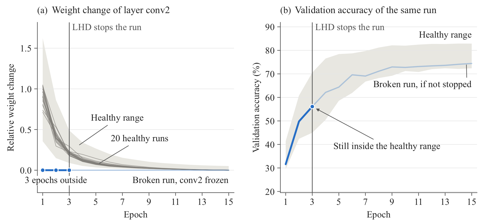

# Layer Health Diagnostics: my network had a frozen layer and nothing warned me

### Author

Sohan Bhat

### Published

November 2026

**TL;DR** LHD (Layer Health Diagnostics) checks four signals in every layer against ranges from healthy runs. It caught 411 of 470 broken runs, and the accuracy curve caught 166. A simpler check beats it on frozen layers.

I trained SignNet, a small CNN for German traffic signs (GTSRB). It got stuck at 76% accuracy, and I spent weeks tuning it. The real problem was one convolutional layer I had left out of the optimizer, so it sat frozen the whole time. **Fixing it raised accuracy to 87%.**

Nothing warned me. Training finished without an error and gave me a worse model. These are called silent failures, and LHD is my project for catching them.

## Layer Health Diagnostics

After every epoch, LHD logs four signals for each layer: weight change, gradient norm, weight norm, and the fraction of dead units. It compares each one with the range it stayed in during healthy runs of the same network. Broken runs never set that range. **When a signal stays out of range for three epochs in a row, LHD stops the run and names the layer and a likely cause** ([Figure 1](#figure-1)).

**Figure 1:** In a CNN run with a frozen layer, weight change (left) stays at 0 while validation accuracy (right) still looks healthy.

## Does LHD beat the accuracy curve?

**Setup**

- **Networks:** a fully connected network on Fashion-MNIST, a CNN on GTSRB, and a character transformer on Tiny Shakespeare.
- **Runs:** 885 in total. Per network, 20 healthy runs set the ranges. 470 runs were broken, 150 fresh healthy runs counted false alarms, and the rest tested other faults.
- **Faults:** one per broken run, either a frozen layer (my SignNet bug) or dead units (10%, 25%, or 50% of a layer's units forced to output zero).
- **Compared with:** the accuracy curve, which fires when validation accuracy stays below the lowest healthy value for three epochs in a row.

| | LHD | Accuracy curve |
|---|---|---|
| Broken runs caught, out of 470 | 411 | 166 |
| Caught, out of the 105 runs that lost 2 points or more | 94 | 60 |
| Healthy runs flagged, out of 150 | 3 | 7 |

**LHD caught 87% of the broken runs, usually at epoch 3.** On the 162 runs both caught, it fired 4.6 epochs earlier on average, and it named the planted layer in 98% of the runs it caught.

In 223 of the 470 broken runs, the fault cost less than half a point of accuracy, so the curve had little to see. The second row counts only faults that did real damage.

## Where does LHD lose?

**A simpler check beats it on frozen layers.** Testing whether a layer's weights moved at all caught 200 of 200 frozen layers at epoch 1 with no false alarms, two epochs before LHD. For the bug I started with, LHD adds nothing.

**Its gain is on dead units.** Healthy networks lose units on their own, so one fixed threshold doesn't fit every layer. LHD caught 78% of dead unit faults with 3 false alarms. SageMaker Debugger's default rule caught 40% with 22.

**It still missed faults.** With 10% of a layer's units killed, LHD caught 57% of runs. In the CNN's dense layer, healthy runs already had between 36% and 70% of units dead, so even with 50% killed it caught 1 of 10 runs.

**The false alarms have a cause.** Two of the 3 came from a CNN layer with 16 filters, where one dead filter crosses the threshold.

**These were planted faults.** I made them to show up in the signals LHD measures, and I haven't tested it on real bugs. I also never put a fault in the data, like flipped labels, so I don't know if LHD would notice one.

## Background and Related Works

[AutoTrainer](https://doi.org/10.1109/ICSE43902.2021.00043), [DeepDiagnosis](https://doi.org/10.1145/3510003.3510071), and [SageMaker Debugger](https://docs.aws.amazon.com/sagemaker/latest/dg/debugger-built-in-rules.html) already check signals like these, and [wandb](https://www.wandb.com/) shows them on a dashboard. The first three use thresholds picked in advance, while LHD measures each layer's healthy range from healthy runs of the same network.

## Code and data

The code and every saved run are in [the repo](https://github.com/sohan-bhat/lhd). [The full PDF](https://github.com/sohan-bhat/lhd/blob/main/paper/lhd.pdf) has every table.

## Who did what

I came up with the idea, designed the experiments in an earlier proposal, and wrote the core LHD library (signals, detector, and diagnosis), with Claude, made by Anthropic, providing function outlines and docstrings. Claude wrote the experiment scripts that trained and scored the networks, ran the training runs, wrote the analysis and figure code, and drafted parts of the full PDF, including the results and related work. Claude also wrote the first draft of this post. I directed the project, decided what to test and change, and I'm responsible for all of its content.
