# HALT results

Generated by `python -m experiments.report` from 555 training runs. Settings were fixed before any broken run was trained: margin 0.5, floor 0.05, patience 3. The healthy band uses calibration seeds 0 to 19 only. Fresh healthy runs and broken runs use seeds from 1000 up and never touch the band.

## Pooled over all three architectures

- Broken runs with a frozen layer or dead units: 405
- Caught by HALT: 89.1% (361/405, 95% CI 86 to 92%)
- Right layer when caught: 99.2% (358/361, 95% CI 98 to 100%)
- Right cause when caught: 97.8% (353/361, 95% CI 96 to 99%)
- Caught by the accuracy curve at any point: 35.8% (145/405, 95% CI 31 to 41%)
- HALT flagged the run before the accuracy curve did: 84.4% (342/405, 95% CI 81 to 88%)
- Of the runs HALT caught, the accuracy curve never noticed: 60.9% (220/361, 95% CI 56 to 66%)
- Mean compute saved per broken run: 71.5%
- HALT false alarms on fresh healthy runs: 2.2% (2/90, 95% CI 1 to 8%)
- Accuracy curve false alarms on the same runs: 6.7% (6/90, 95% CI 3 to 14%)
- Mean epochs HALT was earlier than the accuracy curve, with "never" counted as one epoch past the end: 9.5, 95% interval (8.7 to 10.2) from a bootstrap that resamples whole seeds.
- Fault conditions (fault and layer) where HALT was earlier on average: 41 of 47 (p < 1e-10), one-sided Wilcoxon on condition means.
- Seeds where HALT was earlier on average: 27 of 27 (p 7.5e-09).
- Run by run, for reference only since runs that share a seed are not independent: HALT earlier on 342, accuracy earlier on 4, ties 59.

## What the results show and what they do not

These points are written to be read by a skeptic. Each one gives the numbers behind it.

- HALT caught 89% (361/405) of the proposal's broken runs and flagged 2% (2/90) of fresh healthy runs, with the same rules on all three networks.
- HALT was earlier than the accuracy curve on average for 27 of 27 seed groups (one per network and seed) and 41 of 47 fault conditions. Its alarm epoch is mostly 3 because patience 3 makes epoch 3 the earliest possible alarm for a fault planted at epoch 1.
- For frozen layers HALT adds nothing over a one line check. The zero update check caught 100% (183/183) at epoch 1 with 0 false alarms in 90 healthy runs, while HALT caught 100% (183/183) at epoch 3.
- For dead units HALT does better than the fixed thresholds tested, including the defaults of SageMaker Debugger (50%), DeepDiagnosis (70%), and wandb-callbacks (80%). HALT caught 80% (178/222) with 2 false alarms. A fixed dead unit rule at 25% caught 79% (176/222) and flagged 30 of 90 healthy runs, at 50% caught 45% (100/222) and flagged 12 of 90 healthy runs, at 70% caught 3% (6/222) and flagged 0 of 90 healthy runs, at 80% caught 0% (0/222) and flagged 0 of 90 healthy runs, and a rule that fires on any dead unit caught 100% (222/222) but flagged 60 of 90 healthy runs. Healthy networks differ in how many units die on their own, so one threshold cannot fit all of them, and HALT's per layer healthy range can.
- HALT misses small dead unit faults in layers where healthy runs already lose many units, such as 10% in the fully connected network's middle layers and every fraction in the CNN's fc1.
- The planted faults were designed to show up in the signals HALT measures. A frozen layer has a weight change of exactly 0 and a killed unit outputs exactly 0. HALT's high rate of naming the right cause is largely built into that design, since its cause rules map those same patterns.
- Most planted faults did little harm. 202 of 405 broken runs lost under half a point of final accuracy against their healthy twin. The accuracy curve missing those runs is partly the curve being right.
- On broken runs that lost 2 points or more, HALT caught 65 of 73 and the accuracy curve caught 39.
- Not tested here are real bugs found in the wild, large networks, long training runs, other optimizers, and GPU training. The networks are small, and the transformer only reaches about 37% next character accuracy.
- The accuracy cost uses one healthy twin per broken run, so it carries noise. Some broken runs ended above their twin, which shows up as a negative mean cost.

## HALT against other detectors

Pooled over all three networks, on the proposal's broken runs. The simple fixed checks need no healthy runs and were added after the core results to test whether HALT beats rules anyone could write by hand. Earlier, later, and tie compare each detector with HALT run by run.

| Detector | Frozen layers caught | Dead units caught | Median alarm epoch | Earlier than HALT / later / tie | Healthy runs flagged |
|---|---|---|---|---|---|
| HALT | 100% (183/183) | 80% (178/222) | 3.0 | n/a | 2% (2/90) |
| Accuracy curve, 3 epochs below healthy | 60% (110/183) | 16% (35/222) | 6.0 | 4 / 342 / 59 | 7% (6/90) |
| Accuracy curve, 1 epoch below healthy | 85% (155/183) | 48% (107/222) | 3.0 | 118 / 210 / 77 | 32% (29/90) |
| Loss curve, 3 epochs above healthy | 56% (103/183) | 11% (24/222) | 5.0 | 2 / 310 / 93 | 7% (6/90) |
| Zero update check | 100% (183/183) | 0% (0/222) | 1.0 | 183 / 178 / 44 | 0% (0/90) |
| Dead units check, 25% | 15% (27/183) | 79% (176/222) | 1.0 | 203 / 185 / 17 | 33% (30/90) |
| Dead units check, 50% (SageMaker DeadRelu default) | 6% (11/183) | 45% (100/222) | 1.0 | 111 / 267 / 27 | 13% (12/90) |
| Dead units check, 70% (DeepDiagnosis Dead Node) | 0% (0/183) | 3% (6/222) | 1.0 | 6 / 361 / 38 | 0% (0/90) |
| Dead units check, 80% (wandb-callbacks default) | 0% (0/183) | 0% (0/222) | n/a | 0 / 361 / 44 | 0% (0/90) |
| Any dead unit (wandb-callbacks verbose) | 40% (73/183) | 100% (222/222) | 1.0 | 295 / 110 / 0 | 67% (60/90) |
| Zero update or dead units 50% | 100% (183/183) | 45% (100/222) | 1.0 | 283 / 95 / 27 | 13% (12/90) |

## Does HALT catch faults that cost accuracy

Broken runs split by how much final accuracy they lost against their healthy twin.

| Network | Accuracy cost against twin | Broken runs | Mean cost | HALT | Accuracy curve | Loss curve | Simple fixed checks |
|---|---|---|---|---|---|---|---|
| Fully connected on Fashion-MNIST | under 0.5 pts | 112 | 0.07 pts | 82% (92/112) | 16% (18/112) | 0% (0/112) | 48% (54/112) |
| Fully connected on Fashion-MNIST | 0.5 to 2 pts | 8 | 0.62 pts | 88% (7/8) | 75% (6/8) | 0% (0/8) | 75% (6/8) |
| Fully connected on Fashion-MNIST | 2 pts or more | 10 | 2.93 pts | 100% (10/10) | 100% (10/10) | 100% (10/10) | 100% (10/10) |
| Transformer on Tiny Shakespeare | under 0.5 pts | 74 | 0.20 pts | 100% (74/74) | 20% (15/74) | 23% (17/74) | 47% (35/74) |
| Transformer on Tiny Shakespeare | 0.5 to 2 pts | 96 | 0.88 pts | 100% (96/96) | 70% (67/96) | 80% (77/96) | 99% (95/96) |
| CNN on GTSRB | under 0.5 pts | 16 | -0.64 pts | 56% (9/16) | 0% (0/16) | 0% (0/16) | 62% (10/16) |
| CNN on GTSRB | 0.5 to 2 pts | 26 | 1.33 pts | 69% (18/26) | 0% (0/26) | 0% (0/26) | 77% (20/26) |
| CNN on GTSRB | 2 pts or more | 63 | 7.14 pts | 87% (55/63) | 46% (29/63) | 37% (23/63) | 84% (53/63) |
| All three | under 0.5 pts | 202 | 0.06 pts | 87% (175/202) | 16% (33/202) | 8% (17/202) | 49% (99/202) |
| All three | 0.5 to 2 pts | 130 | 0.96 pts | 93% (121/130) | 56% (73/130) | 59% (77/130) | 93% (121/130) |
| All three | 2 pts or more | 73 | 6.56 pts | 89% (65/73) | 53% (39/73) | 45% (33/73) | 86% (63/73) |

## By architecture

| | Fully connected on Fashion-MNIST | Transformer on Tiny Shakespeare | CNN on GTSRB |
|---|---|---|---|
| Training runs | 180 | 220 | 155 |
| Epochs per run | 20 | 15 | 15 |
| Broken runs (frozen and dead units) | 130 | 170 | 105 |
| Caught by HALT | 84% (109/130) | 100% (170/170) | 78% (82/105) |
| Right layer, when caught | 100% (109/109) | 100% (170/170) | 96% (79/82) |
| Right cause, when caught | 100% (109/109) | 97% (165/170) | 96% (79/82) |
| Median epoch HALT stops | 3 | 3 | 3 |
| Caught by the accuracy curve | 26% (34/130) | 48% (82/170) | 28% (29/105) |
| Median epoch accuracy notices | 17 | 5 | 8 |
| HALT first | 76% (99/130) | 98% (166/170) | 73% (77/105) |
| Final accuracy still inside healthy range | 69% (90/130) | 59% (100/170) | 70% (74/105) |
| Compute saved per broken run | 68% | 80% | 62% |
| Fresh healthy runs | 30 | 30 | 30 |
| HALT false alarms | 0% (0/30) | 0% (0/30) | 7% (2/30) |
| Accuracy curve false alarms | 3% (1/30) | 17% (5/30) | 0% (0/30) |
| HALT time overhead | 11.7% | 5.8% | 2.2% |
| Fault conditions where HALT was earlier on average | 10 of 13 (p 0.0012) | 17 of 17 (p 7.6e-06) | 14 of 17 (p 6.1e-05) |
| Seeds where HALT was earlier on average | 10 of 10 (p 0.00098) | 10 of 10 (p 0.00098) | 7 of 7 (p 0.0078) |
| Mean epochs earlier, 95% seed bootstrap | 12.4 (11.9 to 12.8) | 8.3 (6.4 to 9.8) | 7.8 (7.2 to 8.5) |

## By fault

| Architecture | Fault | Runs | Caught | Right layer | Right cause | HALT median epoch | Accuracy caught | Accuracy median epoch | Mean accuracy lost |
|---|---|---|---|---|---|---|---|---|---|
| Fully connected on Fashion-MNIST | Dead units 10% | 30 | 33% (10/30) | 100% (10/10) | 100% (10/10) | 3 | 10% (3/30) | 20 | 0.0 pts |
| Fully connected on Fashion-MNIST | Dead units 25% | 30 | 97% (29/30) | 100% (29/29) | 100% (29/29) | 3 | 10% (3/30) | 18 | 0.0 pts |
| Fully connected on Fashion-MNIST | Dead units 50% | 30 | 100% (30/30) | 100% (30/30) | 100% (30/30) | 3 | 30% (9/30) | 17 | 0.2 pts |
| Fully connected on Fashion-MNIST | Frozen layer | 40 | 100% (40/40) | 100% (40/40) | 100% (40/40) | 3 | 48% (19/40) | 3 | 0.8 pts |
| Transformer on Tiny Shakespeare | Dead units 10% | 20 | 100% (20/20) | 100% (20/20) | 100% (20/20) | 3 | 15% (3/20) | 8 | 0.1 pts |
| Transformer on Tiny Shakespeare | Dead units 25% | 20 | 100% (20/20) | 100% (20/20) | 100% (20/20) | 3 | 20% (4/20) | 5 | 0.4 pts |
| Transformer on Tiny Shakespeare | Dead units 50% | 20 | 100% (20/20) | 100% (20/20) | 100% (20/20) | 3 | 50% (10/20) | 6 | 0.7 pts |
| Transformer on Tiny Shakespeare | Frozen layer | 110 | 100% (110/110) | 100% (110/110) | 95% (105/110) | 3 | 59% (65/110) | 5 | 0.7 pts |
| CNN on GTSRB | Dead units 10% | 24 | 54% (13/24) | 100% (13/13) | 100% (13/13) | 3 | 0% (0/24) | n/a | 1.0 pts |
| CNN on GTSRB | Dead units 25% | 24 | 75% (18/24) | 100% (18/18) | 100% (18/18) | 3 | 0% (0/24) | n/a | 1.5 pts |
| CNN on GTSRB | Dead units 50% | 24 | 75% (18/24) | 100% (18/18) | 100% (18/18) | 3 | 12% (3/24) | 7 | 3.3 pts |
| CNN on GTSRB | Frozen layer | 33 | 100% (33/33) | 91% (30/33) | 91% (30/33) | 3 | 79% (26/33) | 8 | 10.1 pts |

## Each signal's part

Each cell shows broken runs caught, then runs where HALT named the right layer and cause, then fresh healthy runs flagged.

| Signals used | Fully connected on Fashion-MNIST: caught / right layer and cause / false alarms | Transformer on Tiny Shakespeare: caught / right layer and cause / false alarms | CNN on GTSRB: caught / right layer and cause / false alarms |
|---|---|---|---|
| all four | 84% / 84% / 0% | 100% / 97% / 0% | 78% / 75% / 7% |
| without weight change | 84% / 53% / 0% | 53% / 35% / 0% | 74% / 47% / 7% |
| without weight norm | 84% / 84% / 0% | 100% / 97% / 0% | 78% / 75% / 7% |
| without grad norm | 84% / 84% / 0% | 100% / 100% / 0% | 78% / 75% / 7% |
| without dead unit fraction | 31% / 31% / 0% | 65% / 62% / 0% | 31% / 31% / 0% |
| only weight change | 31% / 31% / 0% | 65% / 65% / 0% | 31% / 31% / 0% |
| only weight norm | 15% / 0% / 0% | 0% / 0% / 0% | 18% / 0% / 0% |
| only grad norm | 31% / 0% / 0% | 18% / 0% / 0% | 28% / 0% / 0% |
| only dead unit fraction | 70% / 53% / 0% | 35% / 35% / 0% | 53% / 47% / 7% |

## How many healthy runs the band needs

Bands built from random subsets of the 20 calibration runs, 20 draws per size.

| Calibration runs | Fully connected on Fashion-MNIST: false alarms / caught | Transformer on Tiny Shakespeare: false alarms / caught | CNN on GTSRB: false alarms / caught |
|---|---|---|---|
| 2 | 15% / 92% | 0% / 100% | 22% / 88% |
| 3 | 8% / 90% | 0% / 100% | 16% / 86% |
| 5 | 5% / 89% | 0% / 100% | 7% / 83% |
| 10 | 1% / 87% | 0% / 100% | 7% / 81% |
| 15 | 0% / 84% | 0% / 100% | 7% / 79% |
| 20 | 0% / 84% | 0% / 100% | 7% / 78% |

## Misses to read by hand

Broken runs HALT never caught (44), grouped by fault and layer:

| Architecture | Fault | Layer | Seeds missed |
|---|---|---|---|
| CNN on GTSRB | Dead units 10% | conv3 | 1000, 1001, 1002, 1004, 1005 |
| CNN on GTSRB | Dead units 10% | fc1 | 1000, 1001, 1002, 1003, 1004, 1005 |
| CNN on GTSRB | Dead units 25% | fc1 | 1000, 1001, 1002, 1003, 1004, 1005 |
| CNN on GTSRB | Dead units 50% | fc1 | 1000, 1001, 1002, 1003, 1004, 1005 |
| Fully connected on Fashion-MNIST | Dead units 10% | fc2 | 1000, 1001, 1002, 1003, 1004, 1005, 1006, 1007, 1008, 1009 |
| Fully connected on Fashion-MNIST | Dead units 10% | fc3 | 1000, 1001, 1002, 1003, 1004, 1005, 1006, 1007, 1008, 1009 |
| Fully connected on Fashion-MNIST | Dead units 25% | fc3 | 1001 |

Runs where HALT named the wrong layer (3):

| Run | Planted in | HALT named | Cause named | Signals |
|---|---|---|---|---|
| cnn-fault-frozen-fc1-s1000 | fc1 | conv3 | dead_units | dead_unit_fraction |
| cnn-fault-frozen-fc1-s1002 | fc1 | conv3 | dead_units | dead_unit_fraction |
| cnn-fault-frozen-fc1-s1005 | fc1 | conv3 | dead_units | dead_unit_fraction |

Runs where HALT found the right layer but named the wrong cause (5):

| Run | Planted | HALT named | Signals | Epoch |
|---|---|---|---|---|
| transformer-fault-frozen-b1.qkv-s1002 | frozen | vanishing_gradient | weight_change | 3 |
| transformer-fault-frozen-b1.qkv-s1004 | frozen | vanishing_gradient | weight_change | 3 |
| transformer-fault-frozen-b1.qkv-s1005 | frozen | vanishing_gradient | weight_change | 3 |
| transformer-fault-frozen-b1.qkv-s1008 | frozen | vanishing_gradient | weight_change | 3 |
| transformer-fault-frozen-b1.qkv-s1009 | frozen | vanishing_gradient | weight_change | 3 |

False alarms on fresh healthy runs (2):

| Run | Epoch | Layer | Cause named | Signals |
|---|---|---|---|---|
| cnn-fresh-none-s1015 | 4 | conv2 | dead_units | dead_unit_fraction |
| cnn-fresh-none-s1028 | 3 | conv2 | dead_units | dead_unit_fraction |

## Figures

**Figure 1.** How the healthy range is built for one layer of the Fully connected on Fashion-MNIST. Gray lines are the 20 calibration runs that set the range. Blue lines are fresh healthy runs that never touched it. The shaded band is the range after widening by the margin and floor. File `figures/healthy_band_mlp.png`, vector copy `figures/pdf/healthy_band_mlp.pdf`.

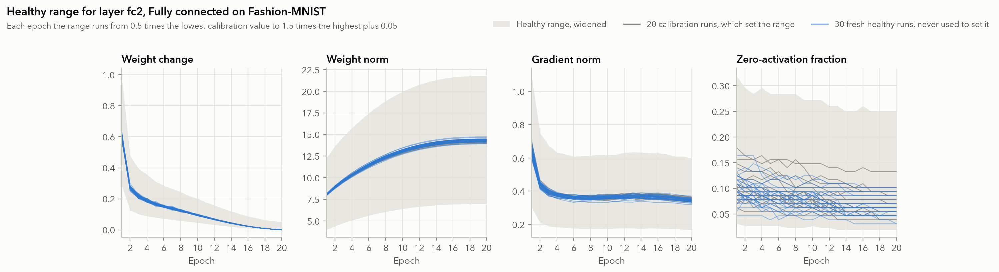

**Figure 2.** How the healthy range is built for one layer of the Transformer on Tiny Shakespeare. Gray lines are the 20 calibration runs that set the range. Blue lines are fresh healthy runs that never touched it. The shaded band is the range after widening by the margin and floor. File `figures/healthy_band_transformer.png`, vector copy `figures/pdf/healthy_band_transformer.pdf`.

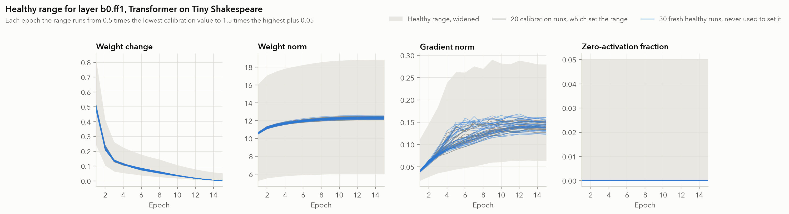

**Figure 3.** How the healthy range is built for one layer of the CNN on GTSRB. Gray lines are the 20 calibration runs that set the range. Blue lines are fresh healthy runs that never touched it. The shaded band is the range after widening by the margin and floor. File `figures/healthy_band_cnn.png`, vector copy `figures/pdf/healthy_band_cnn.pdf`.

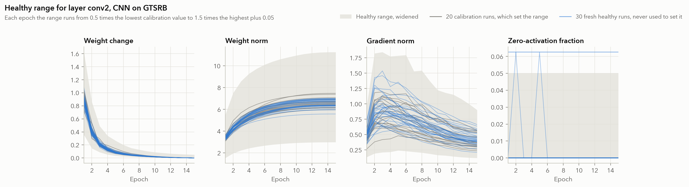

**Figure 4.** Validation accuracy over training. The shaded band is the range of the 20 calibration runs and the dark line is the mean of the fresh healthy runs. Colored lines are the mean of broken runs for each planted fault. File `figures/accuracy_curves.png`, vector copy `figures/pdf/accuracy_curves.pdf`.

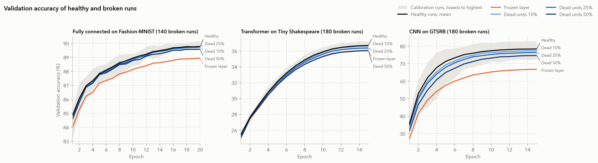

**Figure 5.** One broken Fully connected on Fashion-MNIST run with a frozen layer. Each panel is one signal of the planted layer against its healthy range, and the last panel is validation accuracy. The vertical rule marks HALT's alarm. File `figures/anatomy_mlp_frozen.png`, vector copy `figures/pdf/anatomy_mlp_frozen.pdf`.

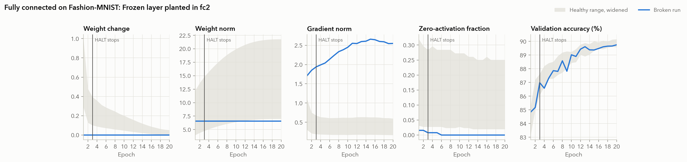

**Figure 6.** One broken Transformer on Tiny Shakespeare run with a frozen layer. Each panel is one signal of the planted layer against its healthy range, and the last panel is validation accuracy. The vertical rule marks HALT's alarm. File `figures/anatomy_transformer_frozen.png`, vector copy `figures/pdf/anatomy_transformer_frozen.pdf`.

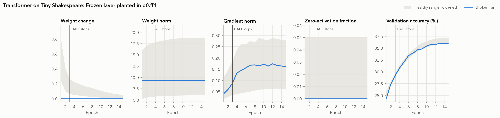

**Figure 7.** One broken CNN on GTSRB run with a frozen layer. Each panel is one signal of the planted layer against its healthy range, and the last panel is validation accuracy. The vertical rule marks HALT's alarm. File `figures/anatomy_cnn_frozen.png`, vector copy `figures/pdf/anatomy_cnn_frozen.pdf`.

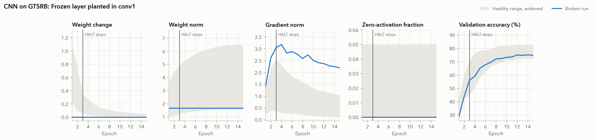

**Figure 8.** One broken Fully connected on Fashion-MNIST run with 25% of one layer's units killed, drawn the same way. File `figures/anatomy_mlp_dead25.png`, vector copy `figures/pdf/anatomy_mlp_dead25.pdf`.

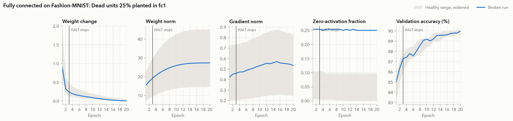

**Figure 9.** One broken Transformer on Tiny Shakespeare run with 25% of one layer's units killed, drawn the same way. File `figures/anatomy_transformer_dead25.png`, vector copy `figures/pdf/anatomy_transformer_dead25.pdf`.

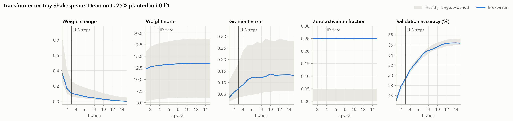

**Figure 10.** One broken CNN on GTSRB run with 25% of one layer's units killed, drawn the same way. File `figures/anatomy_cnn_dead25.png`, vector copy `figures/pdf/anatomy_cnn_dead25.pdf`.

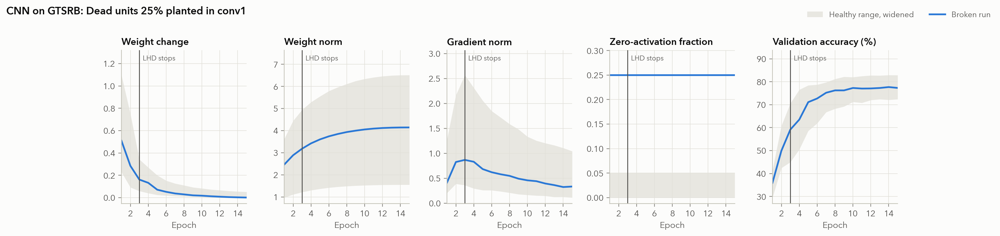

**Figure 11.** Share of the proposal's broken runs flagged by each epoch, for HALT, the accuracy curve, the loss curve, and the simple fixed checks. File `figures/cumulative_detection.png`, vector copy `figures/pdf/cumulative_detection.pdf`.

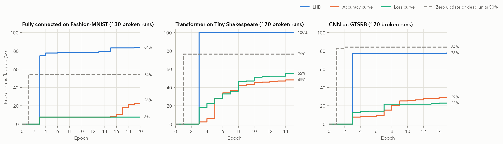

**Figure 12.** Every detector on the same runs, pooled over the three networks. Whiskers are 95% Wilson intervals. File `figures/detector_comparison.png`, vector copy `figures/pdf/detector_comparison.pdf`.

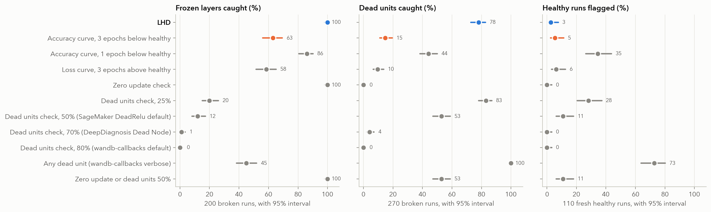

**Figure 13.** Share of dead unit faults caught as the killed fraction grows, for HALT and for the accuracy curve, by network. Whiskers are 95% Wilson intervals. File `figures/dose_response.png`, vector copy `figures/pdf/dose_response.pdf`.

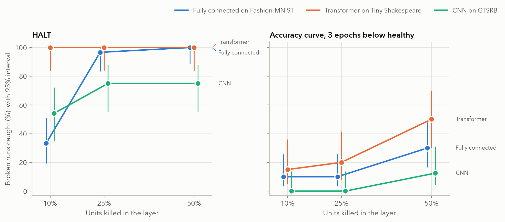

**Figure 14.** Share of broken runs caught, split by how much final accuracy the fault cost against the run's healthy twin. Whiskers are 95% Wilson intervals. File `figures/harm.png`, vector copy `figures/pdf/harm.pdf`.

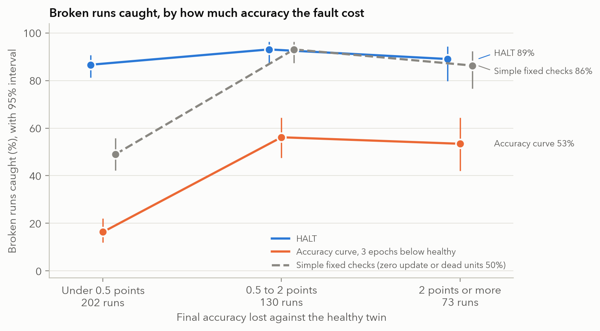

**Figure 15.** Share of fresh healthy runs each detector flagged, with 95% Wilson intervals. File `figures/false_alarms.png`, vector copy `figures/pdf/false_alarms.pdf`.

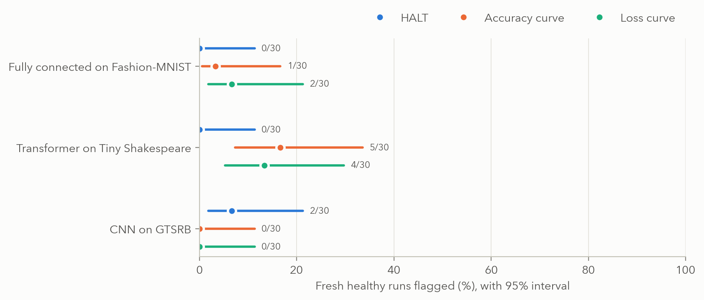

**Figure 16.** Planted fault against the cause HALT named, pooled over the three networks. File `figures/diagnosis_matrix.png`, vector copy `figures/pdf/diagnosis_matrix.pdf`.

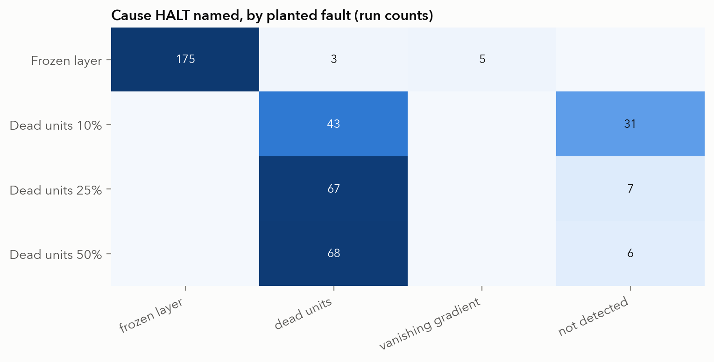

**Figure 17.** Share of broken runs where HALT named both the planted layer and the right cause, by fault and layer. File `figures/per_layer.png`, vector copy `figures/pdf/per_layer.pdf`.

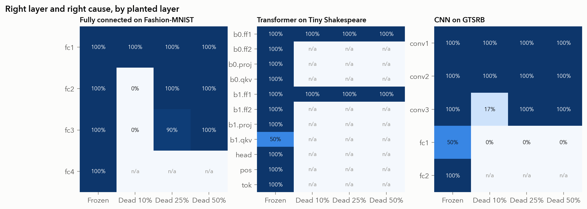

**Figure 18.** HALT with each signal removed, or with one signal alone, on the same runs. File `figures/ablation.png`, vector copy `figures/pdf/ablation.pdf`.

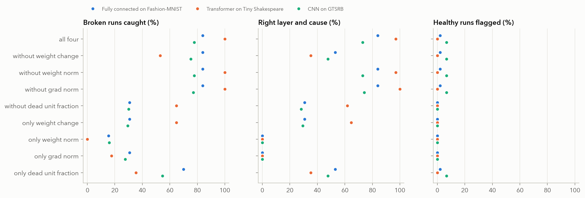

**Figure 19.** Broken runs caught and healthy runs flagged as the margin changes, at floor 0.05. Solid lines use patience 3 and dashed lines patience 1. The rule marks the margin fixed before testing. File `figures/tradeoff.png`, vector copy `figures/pdf/tradeoff.pdf`.

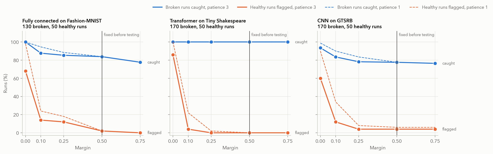

**Figure 20.** Broken runs caught and healthy runs flagged for every margin and patience, at floor 0.05. File `figures/sensitivity.png`, vector copy `figures/pdf/sensitivity.pdf`.

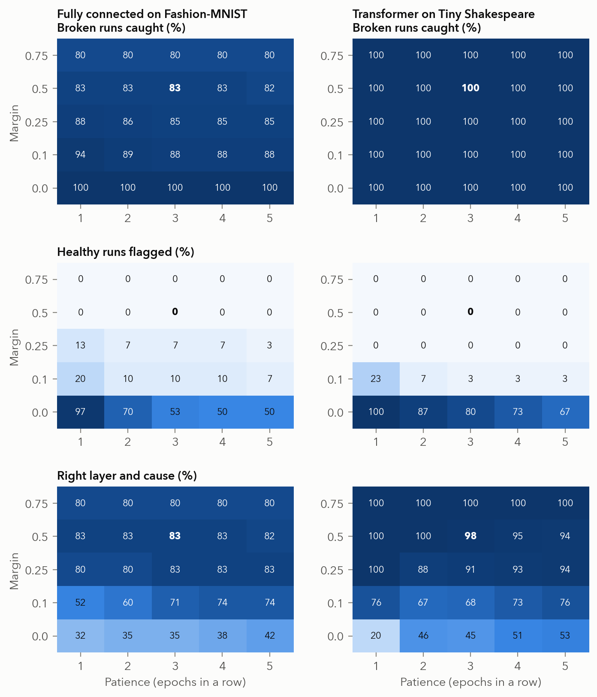

**Figure 21.** False alarms and broken runs caught when the healthy range is built from fewer calibration runs, 20 random draws per size. File `figures/calibration_size.png`, vector copy `figures/pdf/calibration_size.pdf`.

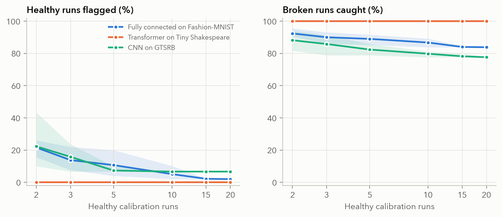

**Figure 22.** Accuracy each fault cost against when each detector noticed it. File `figures/silent_damage.png`, vector copy `figures/pdf/silent_damage.pdf`.

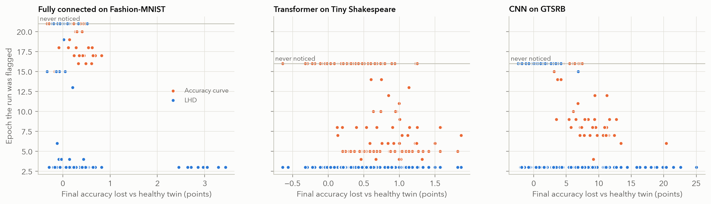

